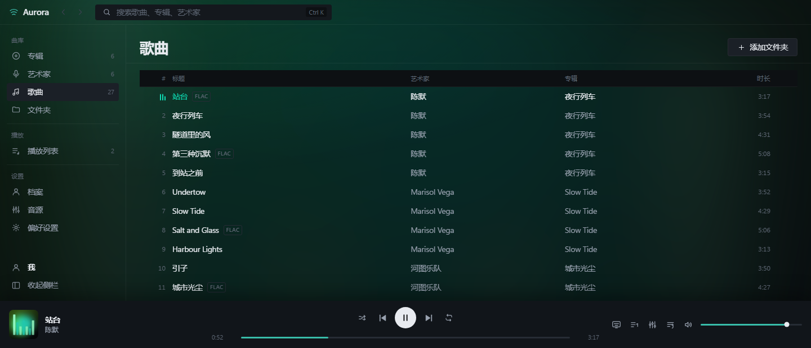
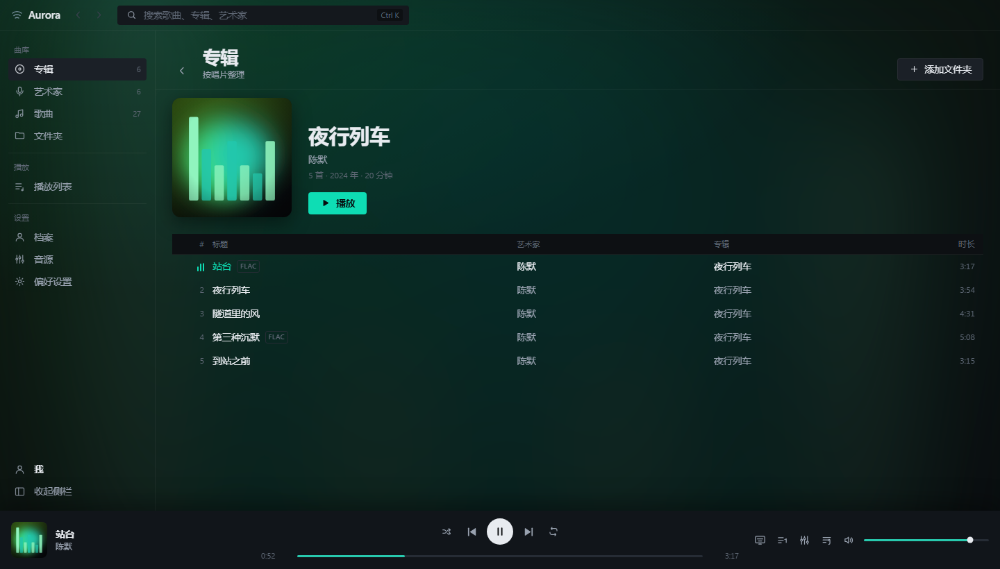
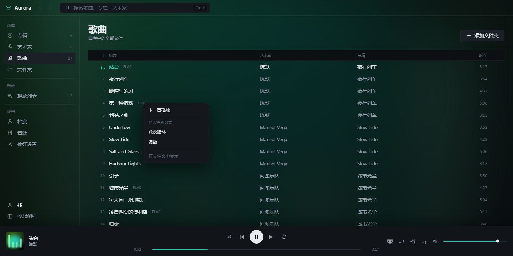
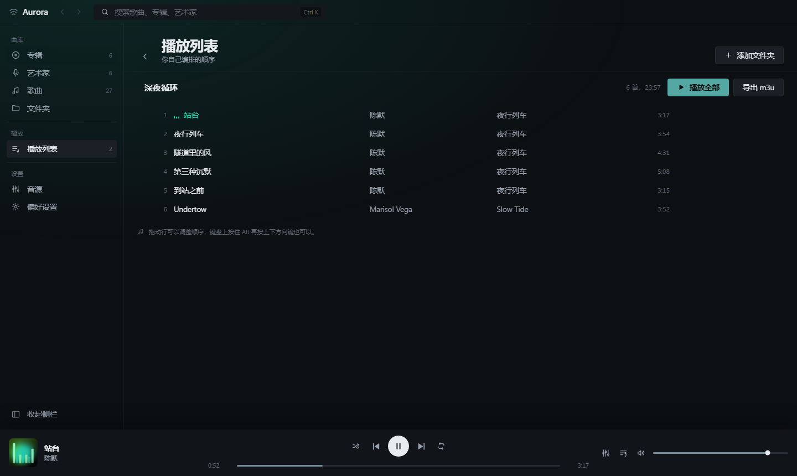
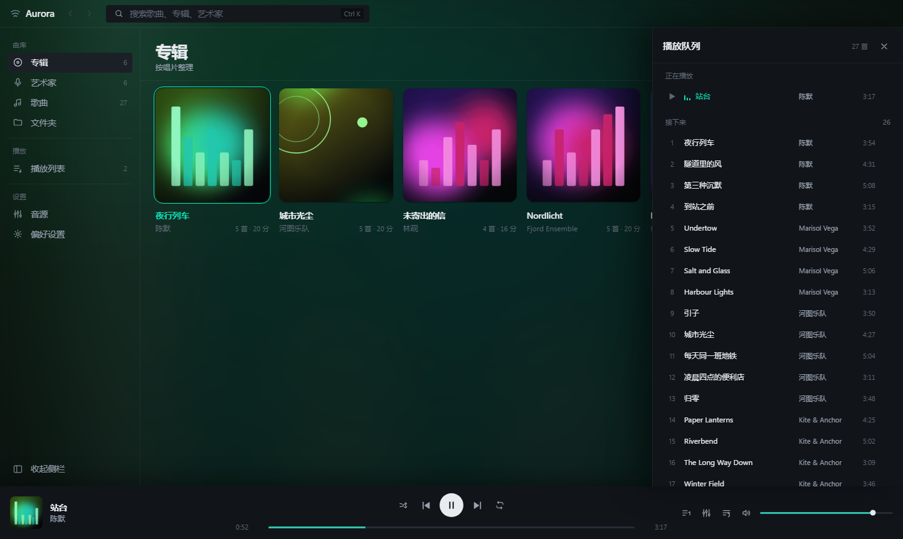
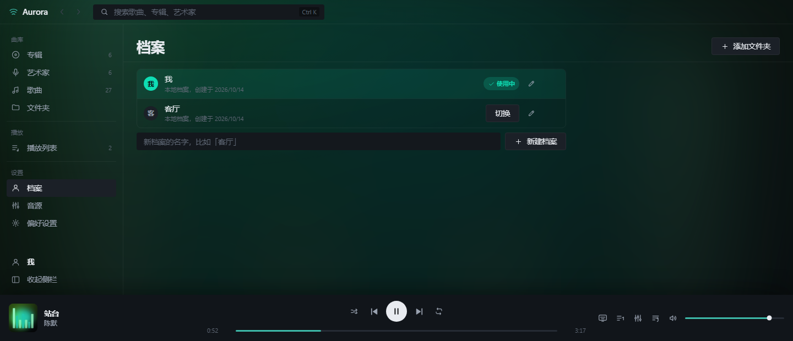

# Aurora

一个**本地优先**的 Windows 桌面音乐播放器：曲库、播放列表和歌词都留在你自己的电脑上，
主界面是一块**歌词舞台**——活动歌词居中放大，背后是随音频驱动的极光带与粒子。

*A local-first desktop music player for Windows, built around an immersive lyric stage.*


*沉浸歌词舞台：活动行居中放大并发出专辑主色的光，上下各四行按距离衰减，背后是随音频驱动的极光带与粒子。*



*曲库视图。整个窗口的色偏来自当前播放专辑的封面——模糊到认不出，再压暗到不影响文字对比度。*



*点封面进入专辑页：完整的曲目顺序、可点的艺术家、以及一个明确的播放按钮。
以前点封面就直接播放，没有「先看看这张专辑有什么」的余地。*



*右键任意一行，或点行尾浮现的 ⋯：下一首播放、加入某个播放列表、在文件夹中显示。*



*播放列表：拖动行排序，或按住 Alt 加方向键；m3u 导入导出的入口在列表页。*


*桌面歌词：一个独立的透明置顶窗口。默认鼠标穿透，所以它永远不会挡住你点它下面的东西；
解锁后才能拖动和调节字号。`Ctrl+Alt+L` 显示/隐藏，`Ctrl+Alt+K` 锁定/解锁。*



*播放队列按**实际播放顺序**排列：开启随机后看到的就是真要播的顺序。*



*档案：侧栏底部常驻显示当前档案。播放列表按档案分开存放，切换档案就是换一套歌单。*

---

## 设计取向

播放器这个题目最容易滑向「近黑背景 + 一个亮色强调 + 圆角卡片网格」的默认答案。
Aurora 的做法是：**界面本身不带颜色，所有彩度都来自当前播放专辑的封面。**

封面被绘制到一张 48×48 的离屏画布上，按 4 位/通道量化取主色，再按「饱和度 × 明度居中 × 面积」
打分，挑出至多四个色相可区分的颜色，写进 CSS 自定义属性。于是进度条、导航指示器、
播放栏辉光、舞台的极光带全部随专辑变色。没有播放的时候，整个界面是无彩的。

大体上，你在界面上看到的每一种颜色都来自当前这张封面。

界面上不写说明文字。曾经每个视图标题下面都有一行自我描述（「专辑／按唱片整理」「音源／Aurora 从哪里
读取音乐」），设置页和档案页开头也有整段解释——那些文字的特征是读一次就永远略过，还占掉了真正
有用的位置。现在的规矩是：

> **界面只报状态和结果，不解释自己。** 标题、标签、按钮说清楚「这是什么」就够了；
> 「为什么这样设计」「怎么用」「支持哪些格式」属于这份 README。

唯一的例外是两处**做决定必需**的信息，都压到一行：启用在线歌词前告知会发送歌名到 lrclib.net，
以及更新面板里「只提示，不自动安装」。这两行说的是接下来会发生什么，所以留着。

其余部分保持克制——全局只有一个圆角以外的视觉重心（舞台），
一套 4px 间距、三档圆角、三段文字灰阶。字体用 Segoe UI Variable
（Win11 自带的可变光学尺寸字体），时间码用 `tabular-nums` 而不是等宽字体：
桌面原生播放器该有系统原生感，不该像套壳网页。

---

## 功能现状

如实标注。「已实现」指代码写完并通过类型检查与构建；**尚未在真实 Electron 窗口里跑过**
（见下方「已知限制」）。

| 功能 | 状态 |
| --- | --- |
| 本地曲库扫描（递归、扩展名白名单、可取消、增量缓存） | 已实现 |
| 标签解析：标题/艺术家/专辑/流派/年份/音轨号/时长/码率/采样率/编码 | 已实现 |
| ReplayGain 读取与峰值限幅播放 | 已实现 |
| 私有媒体协议：Range 请求、CORS、内嵌封面/文件夹封面回退、路径白名单 | 已实现 |
| Web Audio 播放内核：10 段均衡器、淡入淡出、交叉淡化、频谱分析 | 已实现 |
| 播放队列：随机 / 列表循环 / 单曲循环、上一首 3 秒重播语义 | 已实现 |
| 歌词：LRC 解析（多时间戳、offset、逐字标记剥离、GBK/UTF-8 自动识别） | 已实现 |
| 沉浸歌词舞台：Canvas 极光带 + 粒子 + 中心光，封面主色驱动全局配色 | 已实现 |
| 专辑封面墙、歌曲密集列表、艺术家列表与详情、文件夹树 | 已实现 |
| 搜索与相关度排序（标题 > 艺术家 > 专辑，命中位置加权） | 已实现 |
| 播放列表：新建/重命名/删除、拖拽排序、Alt+方向键排序、m3u/m3u8 导入导出 | 已实现 |
| 均衡器面板：10 段推子、5 组预设、双击归零、实时生效 | 已实现 |
| 桌面集成：Media Session → Windows SMTC、硬件媒体键、窗口状态记忆、单实例 | 已实现 |
| 全局快捷键：空格、方向键快进快退、Ctrl+方向键切歌、L 舞台、E 均衡器、Ctrl+K 搜索 | 已实现 |
| 桌面歌词快捷键：Ctrl+Alt+L 显示/隐藏、Ctrl+Alt+K 锁定/解锁 | 已实现 |
| NSIS 安装包 + GitHub Releases 更新检查 | 已实现并验证 |
| 系统托盘（随主题切换深浅图标、播放控制菜单、关闭窗口后继续播放） | 已实现 |
| 任务栏缩略图按钮（上一首 / 播放暂停 / 下一首） | 已实现 |
| 应用图标、托盘图标、缩略图按钮图标（脚本生成的多尺寸资源，无二进制手工资产） | 已实现 |
| 毛玻璃背景：当前专辑封面模糊后作为整窗色偏（带压暗层，不牺牲文字对比度） | 已实现 |
| 在线歌词匹配：本地 `.lrc` 优先，缺失时查 lrclib.net（默认关闭，需用户开启） | 已实现 |
| 播放队列面板：按实际播放顺序显示（含随机排列）、点跳转、可移除、已播放可折叠 | 已实现 |
| 桌面歌词：独立透明置顶窗口、鼠标穿透锁定、拖动与位置记忆、字号调节、全局快捷键 | 已实现 |
| 封面加载失败时降级为占位图（不出现裂图） | 已实现 |
| 专辑详情页：点封面进入，曲目按唱片原序排列，艺术家可点进对应页 | 已实现 |
| 曲目操作菜单：右键或点 ⋯，可「下一首播放」「加入播放列表」「在文件夹中显示」 | 已实现 |
| 当前曲目自动滚入视野（已可见的行不动，不打断手动滚动） | 已实现 |
| 播放位置更新不触发整树重渲染（实测 403 次 → 4 次 / 6 秒） | 已实现 |
| 档案：本机多用户，切换/新建/重命名/删除，**播放列表按档案分开存放** | 已实现 |

---

## 快速开始

需要 **Node.js 20 或更高版本**。

```bash
# 1. 安装依赖
npm install

# 2. 开发模式：Vite 热更新 + Electron 窗口
npm run dev

# 3. 只想看界面，不想装 Electron？
#    这条命令产出一个自包含的单文件 HTML，双击用浏览器打开就行，
#    内置一套演示曲库（含歌词），方便改界面时快速预览。
npm run preview
#    产物：preview-dist/aurora-preview.html

# 4. 打包成 Windows 安装包
npm run dist

# 5. 跑测试（纯逻辑部分，不需要 Electron）
npm test
```

如果 `npm install` 卡住或 Electron 二进制下载不动（国内网络常见），在项目根目录建一个 `.npmrc`
指向镜像即可。这个文件**有意没有提交进仓库**——它会强制所有克隆的人用第三方镜像，
而且 `electron_*` 不是 npm 认得的配置键，会让每一条 npm 命令都多打四行警告：

```ini
registry=https://registry.npmmirror.com
electron_mirror=https://npmmirror.com/mirrors/electron/
electron_builder_binaries_mirror=https://npmmirror.com/mirrors/electron-builder-binaries/
node_gyp_binary_mirror=https://npmmirror.com/mirrors/node-gyp/
```

首次运行后，在左侧「音源」里点「添加文件夹」选择你的音乐目录，Aurora 会自动扫描并建立索引。
之后只会重读有变化的文件——索引里存了每个文件的修改时间和大小。

如果选中的文件夹里没有音乐，界面会**把正在扫描的路径列出来**。这一步是刻意的：
「加进去了但里面是空的」和「点了没反应」在界面上本来长得一模一样，
而所有人都会默认是后者。

### 关于测试

`npm test` 跑的是 211 个针对**不依赖 Electron 的纯逻辑**的用例：LRC 解析、
m3u 编解码与路径解析、播放队列的随机/循环推进与「下一首播放」的插入、
文件夹树构建、版本比较、档案存储的键推导与真实 store 的隔离行为、
以及私有协议那条路径的目录穿越防护。

在线音源那部分单独有一组：歌曲到 `Track` 的映射（id 前缀、时长单位、封面缺失）、
播放失败原因的分级表（未登录 / 会员 / 地区 / 试听 / 下架 / 限流 / 网络 / 服务不可用
各走哪条分支，以及哪一条才允许说「已下架」）、`aurora-remote:` 代理地址的构造与往返解码、
音质档位与回退判断、以及歌词与翻译的合并。这组测试的价值不在覆盖率，而在**把「播不了」
拆成可断言的具体原因**——它们跑不出真实网络，映射表却是照着上游实测的响应逐条写的。

其中两条不是从设计文档推的，是从冷启动实测里反推回来的：上游对「这首歌不可用」是**抛异常**
而不是返回 `code`（异常体里才是真正的 code），所以判定必须先把它抠出来，否则一次下架会被
报成网络故障；另外用户上传的翻唱曲里艺术家 `id` 可能是 **0**，直接拿去请求会得到 404 异常，
所以每个单 id 入口都先过一遍「这个 id 能不能用」——两个守卫都有测试锁住。

代理那一段则完全不需要网络：测试自己起一个监听 `127.0.0.1` 的 `http.createServer`，
然后拿真实的协议处理器去请求它，断言回 403 并且**那个服务器一次都没被访问到**——
证明「内网地址被拒」发生在打开 socket 之前，而不是读到规则后的推断。同一组还覆盖了
`file:`/`data:`/`ftp:` 被拒、CORS 预检的头、以及把 IPv4 地址伪装成 IPv6 的几种写法
（`::ffff:7f00:1`、NAT64、6to4）。最后这几条不是假想：写这组测试时它们当场抓到了一个
真实绕过——URL 解析器会把 `[::ffff:127.0.0.1]` 改写成十六进制形式，而当时的判定只认点分十进制。

之所以只覆盖这些：应用界面和主进程无法在这个仓库的开发环境里运行（见「已知限制」），
所以测试聚焦在那些既容易悄悄出错、又能被独立验证的地方。
写这套测试时它当场抓到了一个真实缺陷——按文件夹播放时会连带播放同前缀兄弟目录
（`C:\Music` 匹配到 `C:\Music2`）的内容。

扫描器是唯一一个**不需要 Chromium 就能跑真实代码**的主进程模块，所以它有一个专门的探针：

```bash
npm run build:electron        # 探针跑的是编译产物，不是源码
npm run scan -- "D:\你的音乐文件夹"
```

它会打印遍历找到了几个文件、每个文件读成了什么，以及有多少个文件因为标签解析失败
退回了文件名。桌面版里「扫不出歌」时，这个比猜快得多。

在线音源也有一个同样定位的探针，但它验的是另一件事——**数据是不是真的来自上游**：

```bash
node scripts/probe-netease6-verify.cjs
```

它会自己走一遍引导，然后搜索、取流、带 `Range` 拉 4KB，并打印响应的状态码、
`content-range`、以及**前四个字节是不是音频**（MP3 的 ID3 头或帧同步字）。
最后两件事才是它的重点：一个是故意取一个不存在的 id，一个是取一首只给试听片段的会员歌——
「什么样才算播不了」得能当场看到，光写在错误提示里不算。

---

## 架构：几个真问题怎么解的

### 1. 为什么不用 `file://` 播放本地音频

把 `<audio>` 接进 Web Audio 图时，如果媒体是跨源的，**MediaElementSourceNode 会输出纯静音**。
开发时页面在 `http://127.0.0.1:5173`，音频在 `file://`，必然跨源。

解法是在主进程注册一个私有协议 `aurora-media:`（`standard + secure + stream + corsEnabled`），
由它按 Range 请求流式返回文件，并带上 `Access-Control-Allow-Origin: *`。
渲染层再给元素设 `crossOrigin = 'anonymous'`，音频才真的进得来。

顺带解决了三件事：Range 请求让**拖动进度条可以跳转**；协议处理器统一做**路径白名单校验**
（只允许读取用户加进曲库的目录）；开发和生产两种模式下行为完全一致。

### 2. 全屏覆盖层的可见性绝不能依赖 CSS 动画完成

这是开发过程中真实踩到的 bug。歌词舞台最初是这样淡入的：

```css
.stage { animation: stage-in 420ms var(--ease-out) both; }
@keyframes stage-in { from { opacity: 0 } to { opacity: 1 } }
```

一旦动画被冻结或没跑完（无头截图、某些远程桌面环境、低性能时掉帧），
**全屏覆盖层就永久停在半透明状态**，底下的曲库整个透出来。

功能面的可见性必须同步成立。现在 `.stage` 立即完全不透明、不做动画，
淡入只加在纯装饰的 Canvas 图层上——那里动画失败最多损失一点观感，
不会影响可读性，也不会让覆盖失效。

### 3. 歌词居中不用测量

歌词窗口固定渲染 9 个槽位（前后各 4 行），每个槽位高度固定、按到中心的距离决定字号与透明度。
因为槽位数量不变，**中间那个槽位永远在垂直中心**，不需要任何滚动位置计算或元素测量，
换行、字体缩放、窗口改变都不会让高亮行漂移。

### 4. 界面颜色的唯一来源

见上方「设计取向」。实现是 canvas 取主色 → CSS 自定义属性。
封面来自内嵌图片标签或同目录的 `cover.jpg`，两者都是同源的，所以画布不会被污染。

### 5. 音源是可插拔的

播放内核从不假设「歌就是磁盘上的文件」。所有「这首歌的音频、封面、歌词从哪来」
都经过 `src/library/source.ts` 里的 `TrackSource` 接口：

```ts
export interface TrackSource {
  id: string
  name: string
  summary: string
  online: boolean
  streamUrl(track: Track): string | null
  artUrl(track: Track): string | null
  lyrics(track: Track): Promise<string | null>
}
```

现在实现了两个：`localSource`（磁盘上的文件）和 `neteaseSource`（网易云，见上方那一节）。
要再接一个远程音源（自建 Navidrome / Subsonic / Jellyfin，或某个官方开放的流媒体 SDK），
就是**加一个对象进 `SOURCES`，并给它产出的 track 标上 `source` id**——
引擎、队列、视图一行都不用改。网易云就是按这个接缝接进去的。

播放本身也有对应的接缝：`src/player/driver.ts` 里的 `AudioDriver`。
Electron 里是 Web Audio 引擎，浏览器预览里是一个合成频谱的假驱动
（这样不启动 Electron 也能调视觉）。

### 6. 播放位置的更新不能经过组件树顶层

播放位置每秒变 60 次。它本来是在 `App` 里从播放器状态里读出来的——于是**整棵组件树每秒重渲染 60 次**，
包括封面墙、侧栏、和那个正在跑 Canvas 的歌词舞台。

现在只有真正画进度条的那两个叶子组件订阅它：播放栏里的进度条，和舞台底部的进度条。
歌词高亮更进一层——它订阅的不是 `position`，而是「当前是第几行」这个**派生出来的数字**，
于是每秒 60 次位置变化被折叠成「歌词换行时才重渲染一次」，一首歌只有几次。

预览构建里带一个渲染计数器和一条基准模式（`#perf`），下面这两个数是它跑出来的：

```bash
npm run preview
# 然后打开 preview-dist/aurora-preview-perf.html，看「偏好设置」里的 App 渲染次数
```

`#perf` 会用定时器以 60 次/秒驱动播放位置——因为无头渲染器几乎不跑 `requestAnimationFrame`，
直接让假驱动跑是量不出来的（第一次这么量得到的是「6 秒 6 次」，那是测量装置失效，不是程序快）。
同一个装置下，把订阅从根组件移到叶子组件前后分别是 **403 次**和 **4 次**。

同一轮还改了四处：

- **扫描不再解码封面。** 之前为了判断「这个文件有没有内嵌封面」，每个文件都要解出一整个图片 Buffer——
  一个真实曲库里就是几百 MB 的分配然后立刻丢弃。现在扫描只读元数据，封面由媒体协议在**真正显示时**
  按需解析；`hasArt` 因此是乐观值，UI 用加载失败降级（`components/Artwork`）来兜底。
- **不可见时停止动画。** 窗口为了不节流播放设了 `backgroundThrottling: false`，副作用是
  `requestAnimationFrame` 也会继续跑。舞台合上或窗口最小化时现在会停掉绘制循环。
- **当前曲目自动滚入视野。** 曲目切换后列表把它带到可视区，用的是 `block: 'nearest'`——
  已经看得见的行完全不动，所以它不会跟正在手动滚动的人抢。
- **滚动是瞬时的，不是平滑的。** 平滑滚动由 `requestAnimationFrame` 驱动，窗口最小化或系统开启
  「减少动态效果」时会停住；而一首找不到的歌，比一次不滑动的跳转更糟。

这两条滚动行为有对照证据。预览里的 `#songs-far` 会让播放从第 19 首开始：

| 预览屏 | 第一行可见 | 当前曲目 |
| --- | --- | --- |
| `aurora-preview-songs.html` | #1 | #1，本来就在屏幕上 |
| `aurora-preview-songs-far.html` | **#5** | **#19，已滚入可视区** |

关键在于未滚动的那张里，最后一行可见的是 #18——第 19 行确实在屏幕外。滚动是真发生了的。

### 7. 桌面歌词窗口的锁

桌面歌词是一个独立的、无边框、透明的置顶窗口。它的核心只有一件事：**默认不接收鼠标事件**，
这样它永远不会挡住你点它下面的东西。`setIgnoreMouseEvents(true, { forward: true })` 里的
`forward` 是关键——鼠标移动仍然送达，所以 hover 效果还在，但点击穿过去了。

解锁之后才能拖动和点控制条。窗口用 `showInactive()` 显示，出现时不会把焦点从你手头的事上抢走。
位置和尺寸会记住，并且在恢复时会夹回当前存在的显示器范围内——显示器拔掉之后，
上次保存的坐标可能整个在屏幕外，表现就和功能坏了一样。

### 8. 生产版渲染层不走 `file://`

这是开发时完全看不见、只在打包后炸的一类问题。`file://` 文档的源是**不透明的**，于是两件事同时坏掉：

1. Vite 产物是 `<script type="module" crossorigin src="./assets/…">`。模块脚本要走 CORS，
   不透明源过不了这一关——页面加载成功但**永远空白**。
2. 应用自己的 CSP 写着 `script-src 'self'`。对不透明源来说 `'self'` 什么都匹配不到，
   于是策略把应用自己的 bundle 也拦了。

开发模式下这两条都不会出现，因为 dev server 是真实的 HTTP 源。所以打包后由私有协议
`aurora-app://app/` 提供渲染层文件，文档就有了真实且安全的源，模块加载、`crossorigin`
样式表和 `'self'` 全部按正常规则工作。

协议处理器里唯一有安全含义的是路径包含检查，所以它被单独抽成 `electron/app-paths.ts` 里的
纯函数并写了测试——`..`、百分号编码的 `..`、绝对路径（含 Windows 盘符）、NUL 字节、
畸形编码，每一条都是「读到了曲库之外的文件」的尝试。

### 9. 档案：一套歌单只在它自己的槽里

一个只换标签、不隔离任何数据的档案切换器，比没有档案更糟——因为它看起来是能用的。
所以档案切换时，播放列表 store 会被重新指向另一个存储槽。

zustand 的 persist 中间件在**每一次**状态变化时都会写盘，包括为了清空状态而做的那次变化。
这两件事撞在一起就是一个会丢数据的陷阱：

```
先清空 → 写入空数组 → 再水合 → 读到的已经是空的 → 用户的歌单没了
```

所以顺序是反过来的：**先读存储槽**。只有确认它确实是空的，才重置状态——
这次重置写盘是安全的，因为没有东西可丢。

另一个坑在初始化时：store 在任何档案存在之前就会水合一次。如果那时就去「采纳」旧版本的
共享数据，它会落进一个没有档案会去看的占位槽里，表现就是升级之后歌单消失了。
所以旧数据只在**确实有档案在用时**才被采纳。

第三个坑更隐蔽，而且是**靠预览截图才发现的**：档案原本是在 React 的 effect 里创建的，
而 effect 在首次渲染之后才跑。于是在那之前发生的任何写入，都会落进「当前档案 = 无」对应的
占位槽 `…::default`。等真实档案加载时，那个槽不是它的，数据就被清掉了——界面上的表现
是「刚建的歌单过一秒自己没了」。

修法是把创建档案挪到 `src/main.tsx` 里、`createRoot().render()` **之前**：
任何组件挂载时档案就已经存在，存储槽也已经指向它。切换档案仍由 effect 负责。

这三条都有测试（`tests/profile-isolation.test.ts` 直接驱动真实 store 跑完整的切换流程，
`tests/profile-storage.test.ts` 覆盖键的推导与旧数据采纳），但第三条当时是被一张
「播放列表数量变成 0」的截图抓出来的，不是被测试抓出来的——这也是为什么每一轮都要真的
把界面渲染出来看一眼。

---

## 网易云音乐：接了什么，代价是什么

Aurora 现在能搜索、播放网易云的歌，也能登录你自己的账号看歌单、每日推荐和红心。
**但这不是官方接入，也没有任何授权。** 网易云没有对个人开发者开放的曲库接口
（它的开放平台只面向硬件、车载、App 内嵌等合作方），所以这条路的实现方式，是依赖一个
第三方逆向出来的私有接口：

> [NeteaseCloudMusicApiEnhanced](https://github.com/neteasecloudmusicapienhanced/api-enhanced) ——
> 社区把网易云客户端在用的私有接口重新实现成一套 HTTP API。Aurora 把它的 `@neteasecloudmusicapienhanced/api`
> 当作依赖，在主进程里直接调用。这里没有复制它的源码进这个仓库。

先把话说清楚，README 里能承诺的就这些：

- **仅供个人学习自用。** 这类接口属于未授权访问，也违反服务条款。用不用由你自己决定。
- **不是官方客户端，随时会坏。** 接口是逆向来的，平台一改就可能失效；被风控识别后账号还可能被封。
- **不提供绕过付费的能力。** 不破解 `.ncm` 等加密音频，不破解会员音质，
  不解锁需要付费的专辑，不假装它能播本来没权限播的歌。能播的只有你这个账号本来就有权播的内容。
- **QQ 音乐仍然不接入。** Aurora 里没有它的任何入口。

所以「登录账号播会员曲库」这件事，Aurora 里的形态是：**用你自己的账号，播你自己的权利。**
如果连这个前提都不成立，界面会如实写清楚原因（未登录 / 需要会员 / 地区限制 / 只有试听片段）。
这四种原因在实现里是分开的错误类型——把原因合并成一句「播不了」的播放器，会让人以为是软件坏了。

至于另一条路——平台自己开放给第三方的接口——依然成立，只是 Aurora 目前只把它写在文档里：

| 平台 | 官方通道 | 能否播放订阅曲库 |
| --- | --- | --- |
| Spotify | Web API + Web Playback SDK | 可以（需 Premium） |
| Apple Music | MusicKit JS | 可以（需订阅） |
| Last.fm | 公开 API + OAuth | 记录与同步，不提供音频 |
| ListenBrainz | 公开 API + token | 记录与同步，不提供音频 |
| 自建服务 | Navidrome / Subsonic / Jellyfin | 可以（你自己的曲库） |

这些都可以通过上面第 5 点的 `TrackSource` 接进来。

**但这些都只写在 README 里，界面里一个都不列。** 档案页一度把上面这些平台逐个列出来、
标上「待接入」，后来删掉了：设置页不是路线图，六行没做的东西读起来就是六个没兑现的承诺，
而且会让人以为某个入口只是灰着、点一下就能用。

现在的规矩是：**界面上只出现能用的东西。没做的功能没有入口，也不占位置。**
想知道能接什么、怎么接，来看这份文档。

---

## 已知限制

- **应用本身还没有在真实 Electron 窗口里端到端跑过。** 开发所在的进程沙箱无法启动 Chromium
  （`app.whenReady()` 不返回），所以界面是通过浏览器渲染加无头截图验证的，主进程代码通过了
  类型检查、也成功打包出安装程序，但「双击安装、扫码播放」这条完整路径未经实机验证。
  第一次运行遇到问题请开 issue。
- 在线歌词匹配只接了 lrclib.net 一个源（见下方说明）。
- **网易云接入依赖第三方逆向接口，随时可能失效。** 它不是官方接入，见上方「网易云音乐：
  接了什么，代价是什么」。未登录也能搜索和播放，登录只解锁歌单、每日推荐、云盘和红心；
  需要会员、受地区限制或只剩试听片段的歌会分别提示原因，不会笼统报「下架」。
- **曲库索引和在线音源是两套数据。** 网易云的歌不进本地曲库，也不参与档案隔离，
  它由自己的在线视图持有；`music.126.net` 这类地址在渲染层是拿不到的，
  音频一律经主进程的 `aurora-remote:` 代理转发。
- **档案只隔离播放列表。** 曲库、播放偏好、均衡器设置是设备级的，所有档案共用。
  把曲库按档案分开没有意义（那是同一块磁盘上的同一批文件），但播放记录目前也没有分开。
- 大曲库（数万首）首次扫描仍是 I/O 密集的，只是不再解码封面了——每个文件依然要解析元数据。
  有变化时的增量重扫很快。
- 均衡器是 10 段固定频点，不是参数均衡。
- 深色画布上的 Canvas 径向渐变有轻微色带（8 位色深的固有限制），未做抖动处理。

### 在线歌词的来源与隐私

歌词按这个顺序找：

1. 音频文件旁边的同名 `.lrc`（你自己的文件，永远优先，支持 GBK 与 UTF-8）
2. [lrclib.net](https://lrclib.net) —— 一个开源、社区维护、公开提供 API 且不需要凭据的歌词库

第 2 步**默认关闭**。Aurora 的承诺是曲库留在本机，而在线查歌词必然要把歌曲标题和艺术家
发给第三方，所以这个开关放在你这边。开启入口在歌词舞台上
（没有歌词时会显示「在线搜索歌词」按钮），按钮下面直接写明了会发送什么。

命中的歌词会缓存在 `%APPDATA%/Aurora/lyrics-cache/`，所以第二次播放立刻就有，离线也能看，
缓存上限 4 MB 并按最近使用淘汰。

为什么只接 lrclib：它是**存在就是为了被查询**的服务。商业流媒体平台的曲库接口是另一回事
（见上方「网易云音乐：接了什么，代价是什么」）。

### 网易云接入的数据与隐私

- **登录凭据只存本机，且加密。** 登录后拿到的 cookie 用 Electron 的 `safeStorage`
  （Windows 上是 DPAPI，绑定当前用户账户）加密后写进 Aurora 的用户数据目录
  （`netease-session.bin`）。明文不落盘，也不进日志。别人拿到这台机器的文件，也解不开它。
  如果系统没有可用的密钥环，Aurora 会让这次登录只活在这个进程里，而不是退回明文落盘。
- **音频和封面不直连上游，全部经本机代理转发。** 渲染层的 CSP 只放行 Aurora 自己的私有
  scheme，所以网易云的音频、封面都走 `aurora-remote:` 这个本机协议，
  由主进程按 Range 转发。这既是为了让 Web Audio 能同源取流，也把「渲染层能访问哪些地址」
  收敛成一个可以审计的入口：只允许 `http`/`https`，指向本机与内网的地址一律拒绝。
- **该发给网易云的还是发给网易云。** 上面两条说的是「Aurora 自己怎么存、怎么转发」，
  不是「用了就不联网」。搜索关键词、你要播的歌、你的账号 cookie，最终都会送到网易云的服务器，
  这是这条路的固有代价，代理不会改变它。
- **不提供绕过付费的能力。** 不破解 `.ncm` 加密文件，不解锁会员音质，
  不代替你付费。取流失败时界面给出的是具体原因（未登录 / 需要会员 / 地区限制 / 只有试听片段 /
  已下架 / 请求过于频繁 / 网络或服务不可用），不会把「你没这个权限」伪装成「这首歌没了」。
- **退出登录会清掉本机的 cookie。** 不想再用了，登出即可；想彻底清干净，
  删掉用户数据目录里那份加密凭据。

### 关闭窗口的行为

点关闭按钮**不会退出程序**，只是把窗口收进系统托盘，音乐继续播——这是音乐播放器该有的行为。
真正退出要走托盘右键菜单里的「退出 Aurora」。如果托盘图标创建失败（比如图标文件缺失），
程序会退回「关闭即退出」，而不是把自己藏成一个找不回来的进程。

---

## 技术栈

Electron 44 · React 19 · TypeScript 5.9 · Vite 7 · Zustand 5 · music-metadata 11

无 UI 组件库，无图标库（图标是手写的内联 SVG），无 CSS 框架——为了离线可用、体积可控，
以及避免看起来像任何一个现成模板。

---

## 灵感与致谢

界面方向参考了两位作者的作品，**但没有使用它们的任何代码**：

- [Mineradio](https://github.com/XxHuberrr/Mineradio)（XxHuberrr，GPL-3.0，已停更）——
  以电影镜头、粒子视觉和歌词舞台为核心的沉浸式播放器。Aurora 的舞台方向受它启发，
  但视觉系统、媒体协议、播放内核与全部代码均为独立实现。
- [folia](https://github.com/chthollyphile/folia-major)（chthollyphile，闭源）——「Lyrics Reimagine」。

演示曲库里的歌词是为这个项目原创写的，不是任何已发表歌曲的歌词。

---

## 打包与发布

### 打一个安装包

```bash
npm run dist
```

产物在 `release/` 目录：

| 文件 | 用途 |
| --- | --- |
| `Aurora-0.1.0-Setup.exe` | 分发给用户的安装程序（约 106 MB） |
| `Aurora-0.1.0-Setup.exe.blockmap` | 增量更新索引，和安装包一起上传 |
| `win-unpacked/` | 免安装目录，自己测试用，**不要分发**，和 `win-unpacked` 一起发会让人以为是安装包 |

安装程序是 NSIS：非静默安装、可以让用户选安装目录、自动创建桌面与开始菜单快捷方式、
卸载时保留用户数据（曲库索引和设置不会被删）。

### 发布到 GitHub Releases

这个仓库已经配置好了：提交署名、远端地址、以及 `package.json` 里的仓库信息和 LICENSE
版权行都已填成 `23213tt/aurora`。第一次推送只需要：

```bash
git push -u origin main
```

第一次推送会弹出浏览器让你登录 GitHub（用的是 Git for Windows 自带的凭据管理器，
密码不会经过任何第三方）。`-u` 只需一次，之后直接 `git push`。

如果换了 GitHub 账号或仓库名，要改的是这几处：

| 位置 | 内容 |
| --- | --- |
| `git config --local user.name` / `user.email` | 提交署名 |
| `git remote set-url origin <新地址>` | 推送目标 |
| `package.json` → `repository.url` | 项目主页 |
| `package.json` → `build.publish.owner` / `repo` | 应用内「检查更新」去哪个仓库查 |
| `LICENSE` 第 3 行 | 版权归属 |

`build.publish.owner` 决定了应用内「检查更新」去哪个仓库查。填错的话，设置页会如实显示
「这个构建还没有配置发布仓库」，而不是假装已是最新。

**发布新版本的步骤**，把 `package.json` 里的 `version` 改掉，
例如 `0.1.0` 改成 `0.2.0`。这一步不能省——更新检查就是拿这个数字和远端最新 Release 比。

重新打包：

```bash
npm run dist
```

然后提交、打 tag、推送。tag 名要和版本号一致（前面加 `v`）：

```bash
git add -A
git commit -m "release 0.2.0"
git tag v0.2.0
git push --tags
```

最后在 GitHub 网页上打开这个仓库的 Releases，点 `Draft a new release`，
选择刚推上去的 `v0.2.0` 标签，把 `release/Aurora-0.2.0-Setup.exe` 和
`release/Aurora-0.2.0-Setup.exe.blockmap` 两个文件拖进附件区，写上更新说明，发布。

完成后，已经装了 Aurora 的用户最多一天内会在「偏好设置」里看到新版本提示
（也可以手动点「检查更新」），点「打开下载页」会在系统浏览器里打开 Release 页面。

### 关于未签名的安装包

Aurora 没有代码签名证书，这意味着用户会遇到两次系统警告：

1. 浏览器下载时可能提示「不常见的下载」，需要手动选择保留
2. 首次运行安装程序时 Windows SmartScreen 会拦一次，需要点「更多信息」→「仍要运行」

这是所有未签名 Electron 应用的共同处境，不是程序有问题。想消除它只能买一张代码签名证书
（一年几百美元），然后在 `package.json` 的 `build.win` 里配置
`certificateFile` 和 `certificatePassword`。

**这也正是应用内更新只做「检查 + 提示」、不自动安装的原因。** 没有签名就没有可验证的东西，
自动替换正在运行的执行文件是不该做的事。把用户送到浏览器的下载流程里，
让系统警告出现在它该出现的地方，是更诚实的做法。

---

## 许可

MIT，见 [LICENSE](LICENSE)。
